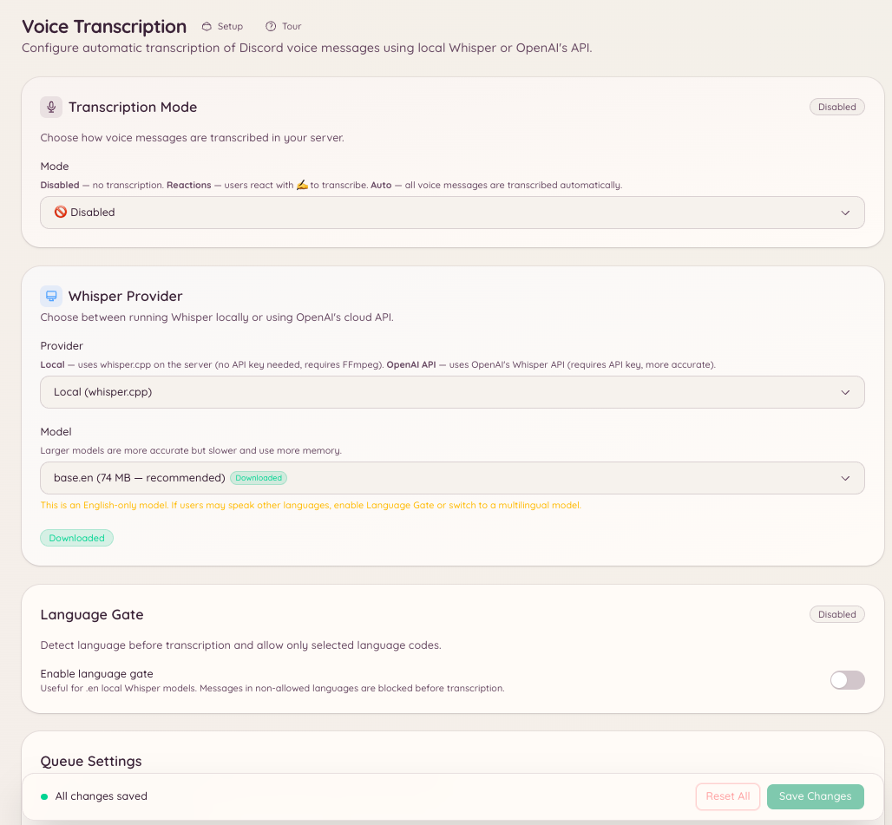

import { DashboardLink } from "/snippets/dashboard-link.jsx";

O plugin de transcrição de voz converte as mensagens de voz do Discord (os áudios que os membros gravam direto no cliente do Discord) em texto. Quando um membro envia uma mensagem de voz em um canal configurado, o bot responde com a transcrição em texto do que foi dito.

Isso deixa as mensagens de voz acessíveis para membros que não podem ou preferem não ouvir áudio, facilita a busca nas conversas e ajuda em ambientes barulhentos onde ouvir não é prático.

<Note>
  Este plugin transcreve as mensagens de voz do Discord (o recurso de gravar uma mensagem de voz no cliente do Discord). Ele não transcreve o áudio dos canais de voz.
</Note>

<Frame>
  
</Frame>

## Configuração

Acesse <DashboardLink to="vc-transcription">**VC Transcription**</DashboardLink> (Transcrição de voz) no painel ou use o comando de barra:

```text
/voice-transcription set <channel>
```

Configure em quais canais o bot deve observar mensagens de voz. Você pode ativar a transcrição em canais específicos ou no servidor inteiro.

```text
/voice-transcription status
```

Mostra quais canais estão com a transcrição ativada no momento.

## Como a transcrição funciona

Quando uma mensagem de voz é enviada em um canal configurado, o bot baixa o áudio, envia para o modelo de fala para texto Whisper e publica a transcrição como resposta à mensagem de voz. A transcrição aparece alguns segundos depois do envio, dependendo da duração do áudio.

As transcrições são claramente identificadas como geradas pelo bot e podem conter erros, principalmente com sotaques incomuns, termos técnicos ou áudio de baixa qualidade.

## Configuração no painel

Acesse <DashboardLink to="vc-transcription">**VC Transcription**</DashboardLink> no painel para:

- Adicionar ou remover canais da lista de transcrição
- Ver o histórico de transcrições de um canal
- Ligar ou desligar a transcrição sem apagar a configuração

## Permissões necessárias

| Ação | Chave de permissão |
| --- | --- |
| Ver a configuração | `vcTranscription.viewConfig` |
| Alterar a configuração | `vcTranscription.manageConfig` |
