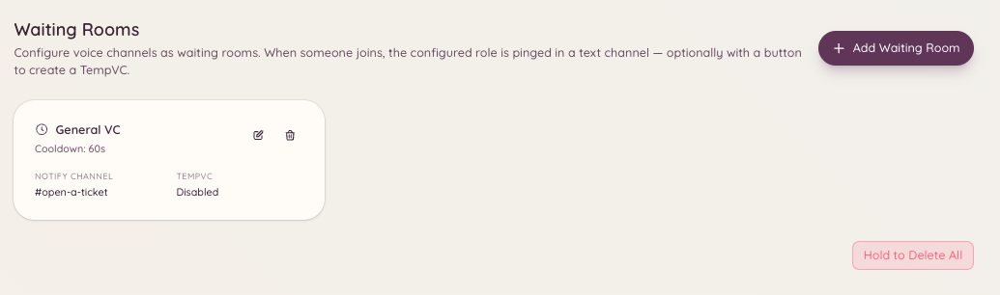

import { DashboardLink } from "/snippets/dashboard-link.jsx";

O plugin de sala de espera monitora um canal de voz que você define como sala de espera. Quando um membro entra nesse canal, o bot publica um aviso em um canal da staff configurado para que alguém da staff possa atendê-lo. Isso é útil para servidores que fazem atendimentos de suporte individuais por voz, entrevistas ou outros casos em que um membro precisa sinalizar que está pronto para conversar.

<Frame>
  
</Frame>

## Como funciona

Um membro entra no canal de voz da sala de espera. O bot envia na hora uma mensagem de aviso para o canal de avisos da staff configurado. A mensagem inclui o nome do membro e o horário. A staff vê o aviso e pode entrar no canal de voz da sala de espera ou mover o membro para um canal privado.

Quando o membro sai da sala de espera, o bot atualiza ou remove o aviso para não deixar alertas desatualizados.

## Configuração

Acesse <DashboardLink to="waiting-room/config">**Waiting Room \> Configuration**</DashboardLink> (Sala de espera > Configuração) no painel.

| Configuração | Descrição |
| --- | --- |
| **Waiting room channel** (canal da sala de espera) | O canal de voz em que os membros entram para sinalizar que precisam de ajuda |
| **Notification channel** (canal de avisos) | O canal de texto onde a staff recebe os alertas da sala de espera |
| **Notification message** (mensagem de aviso) | O modelo de mensagem publicado quando um membro entra |
| **Ping roles** (cargos marcados) | Cargos mencionados no aviso para que a staff seja alertada na hora |

Você pode configurar várias salas de espera, cada uma com o próprio canal de avisos e os próprios cargos marcados.

## Variáveis da mensagem de aviso

| Variável | Substituída por |
| --- | --- |
| `{user}` | Uma menção ao membro que entrou |
| `{user.name}` | O nome de exibição do membro |
| `{channel}` | O nome do canal da sala de espera |
| `{time}` | O horário em que o membro entrou |

## Como usar o recurso de aceitar

A staff pode clicar no botão **Accept** (Aceitar) na mensagem de aviso para assumir o atendimento de quem está na sala de espera. Assumir marca o aviso como resolvido e impede que várias pessoas da staff atendam a mesma pessoa ao mesmo tempo.

## Permissões necessárias

| Ação | Chave de permissão |
| --- | --- |
| Ver a configuração | `waitingRoom.viewConfig` |
| Alterar a configuração | `waitingRoom.manageConfig` |
| Aceitar membros da sala de espera | `waitingRoom.accept` |
